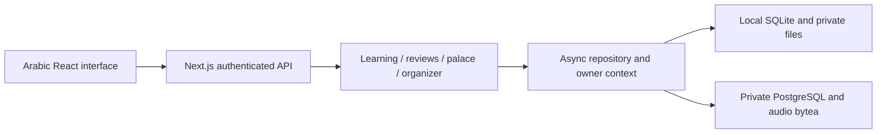

# MQW runtime architecture

The application keeps one Arabic-first React interface and one set of versioned learning/palace rules. Its asynchronous repository supports two storage backends. Backend selection does not change grading boundaries, scheduling, consent, or the meaning of stored evidence.

## Local backend

Without cloud configuration, `src/lib/server/db.ts` uses Node 24 `node:sqlite`. `MQW_DATA_DIR` selects the database/private-audio directory. Serialized callbacks are awaited inside SQLite transactions; independent asynchronous requests cannot interleave one SQLite transaction with another.

This mode needs a private persistent filesystem to survive replacement of a host/container. It is appropriate for local use or an explicitly selected persistent host. It is not durable on a free ephemeral web service.

## PostgreSQL backend

Set `MQW_STORAGE_BACKEND=postgres` and configure server-only `MQW_DATABASE_URL` for the restricted runtime role. A configured URL also selects PostgreSQL when the explicit flag is omitted, but the free deployment should always set the flag so missing credentials fail closed.

The pool uses at most three connections, verified TLS, and the `mqw_private` search path. `MQW_DATABASE_CA_CERT` can provide a verified CA bundle when needed. No administrative connection or Supabase secret key goes into browser code.

Transactions retain one client, await the callback, and hold a transaction-scoped advisory lock for evidence/idempotency transitions. `withOwner` establishes transaction-local `mqw.user_id` from the verified session and rejects attempts to switch owners inside a transaction. The repository rejects work that escapes its completed transaction context.

The runtime migration chain is `supabase/migrations/20261118155145_runtime_private_store.sql` followed by `supabase/migrations/20261118155344_voice_ownership_index.sql`. The latter adds the composite ownership index without rewriting the first migration. Both are applied to the inspected Free project; `supabase/runtime/schema.sql` reflects their combined state. The old normalized teaching schema is archived at `supabase/proposals/normalized_schema.sql`.

## Identity and database authorization

The app retains custom email/password authentication, scrypt password hashes, opaque hashed session tokens, and HttpOnly cookies. Supabase hosts PostgreSQL; Supabase Auth/JWTs and `auth.uid()` are not used by this runtime.

The private schema contains users, sessions, records, setup_tokens, idempotency, file_cleanup, and voice_blobs. Every table enables and forces RLS. Only `mqw_app` receives ordinary runtime table privileges; anonymous, authenticated and service-role Data API identities have no private-schema access.

Records, idempotency and voice rows enforce matching `mqw.user_id` through both visibility and write checks. Auth/session/setup/cleanup policies intentionally allow the trusted backend to resolve an identity before owner context exists. The runtime credential is server authority and must never be given to a visitor. No SECURITY DEFINER function is needed.

## Evidence and audio

Record IDs, serialized payloads, content versions, original timestamps, answer grading source, review history, palace snapshots and submission receipts keep their existing semantics. A backend migration must preserve them, rather than reconstructing attempts from summary metrics.

Local audio uses private files. Cloud audio uses owner-scoped `bytea` rows with a composite foreign key to metadata and transactional deletion cascades. The upload limits remain 20 MiB per file and 200 MiB per account; those bytes consume PostgreSQL quota. The cloud path does not depend on Supabase Storage or a persistent Render disk. Export streams bounded audio chunks rather than assembling all recordings in memory.

## Verification boundaries

The runtime SQL template passed 45 isolated PGlite PostgreSQL role/RLS/ownership/cascade checks. Recorded local regression evidence also passed 38 SQLite/async-repository tests, nine Chromium journeys and one dedicated cache-reproduction browser check. The suite includes 18-process cold SQLite initialization; TypeScript and the corrected production build passed.

A separate real local PostgreSQL 17.12 server passed an application wire-protocol smoke test with verified TLS CA/SAN and a non-superuser, non-bypass `mqw_app` role. The test exercised concurrent lesson start/submission deduplication, lessons/reviews, private five-locus palace reveal/rating, A/B RLS and context reset, 1 MiB + 5 byte audio playback/export, rollback, and password-confirmed deletion cascades. It was restricted to loopback/synthetic data, and its temporary server, data and credentials were removed.

Local checks remain distinct from hosted acceptance. The recorded Free release `35aac55` separately reached Live, passed 21/21 final anonymous HTTPS probes and seeded authenticated flows, and retained identical full-state hashes, original audio/export content and an existing session cookie across instance replacement. Password-confirmed cleanup and independent zero-row counts removed the synthetic accounts/evidence/audio without consuming the real owner's invitation. See [release verification](RELEASE_VERIFICATION.md). Free service limits, missing reset-email delivery, operational PostgreSQL backups and physical-iPhone testing remain explicit operating constraints.
